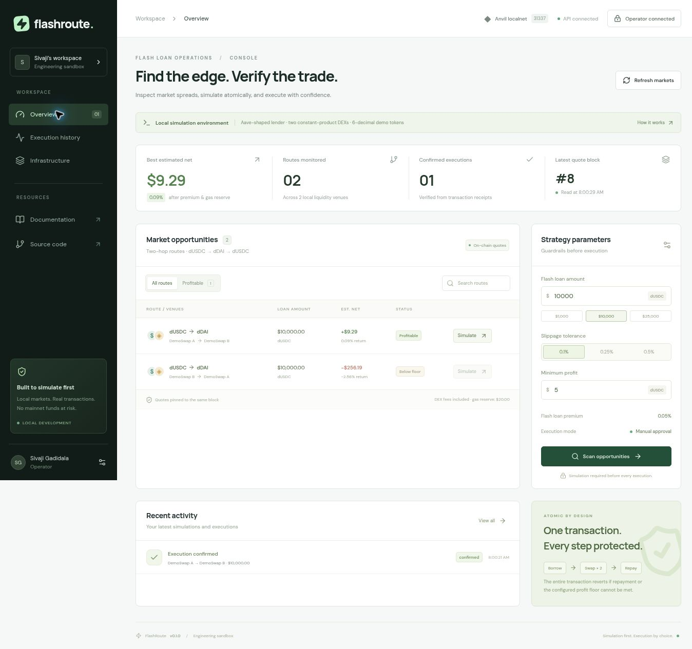
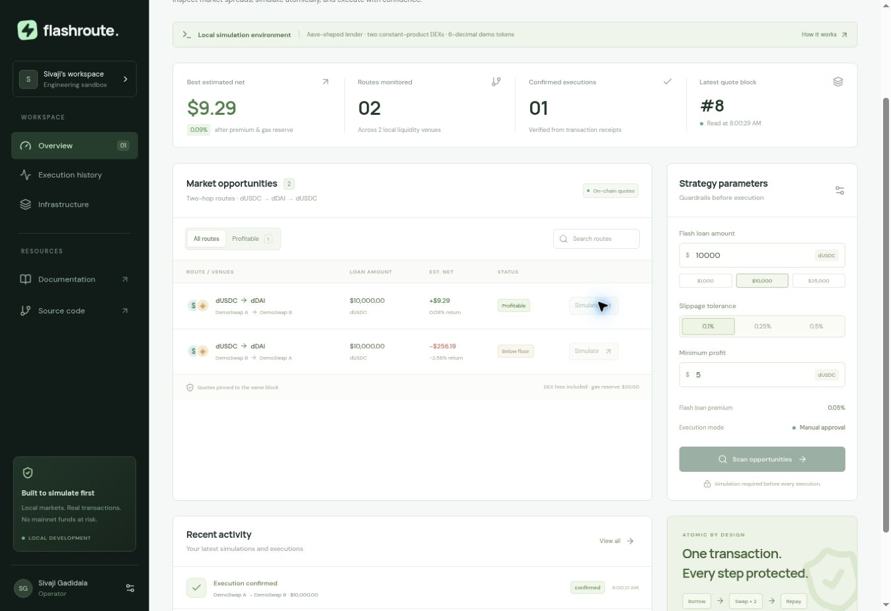
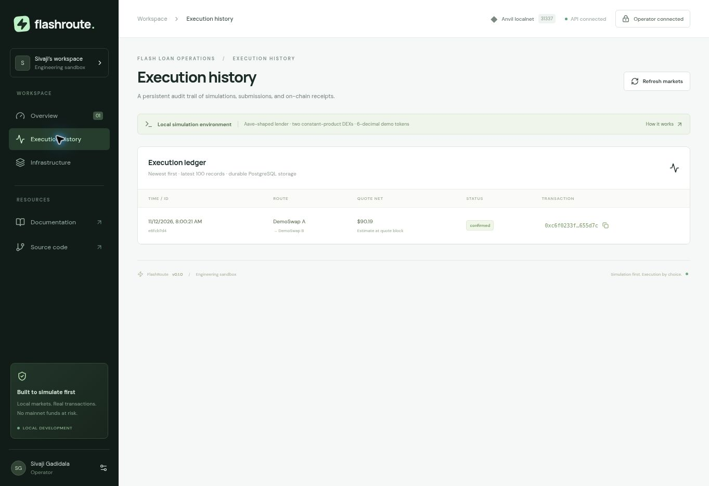
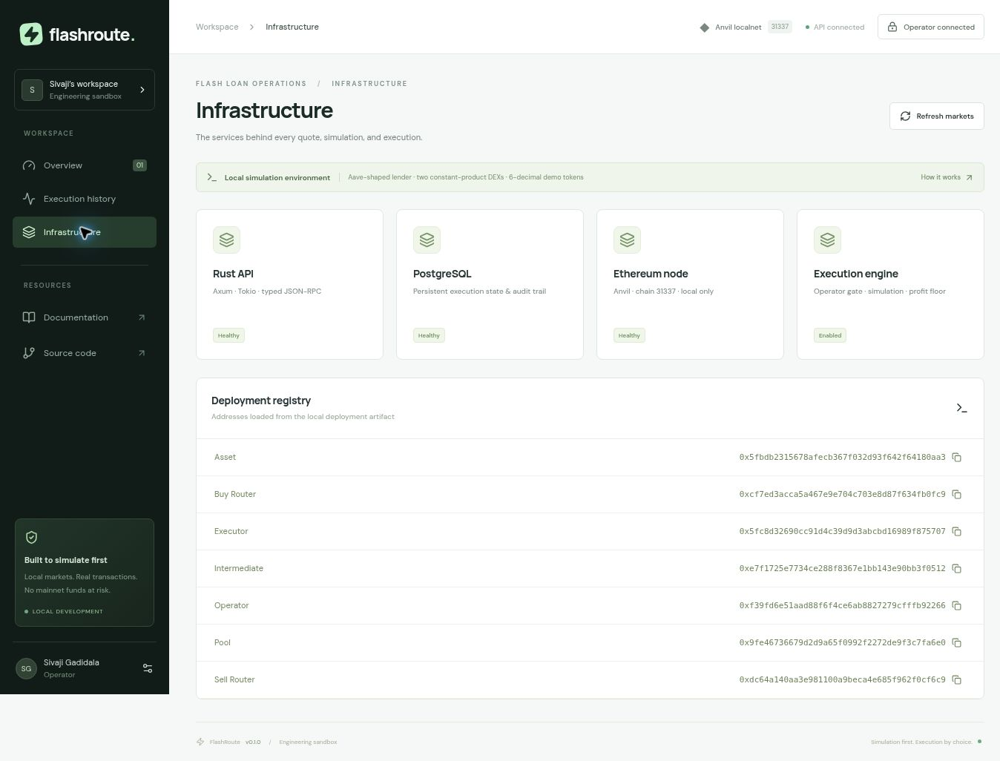

<div align="center">

# ⚡ FlashRoute

### Find the edge. Verify the trade.

**A full-stack flash-loan arbitrage engineering sandbox.**  
Solidity + Foundry · Rust + Axum · React + TypeScript · PostgreSQL · Docker

[](https://github.com/sivajisj2/flashroute/actions/workflows/ci.yml)
[](LICENSE)
[Architecture](docs/ARCHITECTURE.md) · [Quick start](#quick-start) · [API](docs/API.md) · [Deployment](docs/DEPLOYMENT.md) · [Career guide](docs/CAREER_GUIDE.md)

</div>

FlashRoute connects an operator console to real local EVM markets: inspect two-hop spreads, simulate an Aave-shaped flash-loan transaction, review the calldata and gas estimate, then execute against Anvil and track its receipt in a persistent ledger.

**Release scope:** a production-oriented portfolio foundation with a working local execution path. It is unaudited, does not promise returns, and does not submit mainnet transactions. The backend requires chain 31337. The contracts expose Aave V3 / V2-router integration boundaries; the default lender, tokens and AMMs are clearly labeled local fixtures. See [security assumptions](docs/SECURITY.md).

## Application



<details>
<summary>Simulation review, execution history and infrastructure</summary>





</details>

Screenshots show the running application connected to its Rust API and seeded local chain. Quotes and demo execution states are not live mainnet activity.

## What is implemented

| Layer | Features |
|---|---|
| Smart contracts | Restricted operator, asset/router allowlists, authenticated callback, active-plan binding, slippage/deadline limits, premium repayment, delta-based profit floor, owner pause/rescue, two-step ownership |
| Market fixture | Mintable 6-decimal tokens, Aave-shaped lender, two constant-product AMMs with real reserve changes and 0.30% fees |
| Rust API | Typed Alloy calldata, block-pinned quotes, premium reads, eth_call, gas estimation, validation, atomic SQL claims, idempotent execution and receipt worker |
| Console | Searchable routes, strategy controls, simulation inspection, explicit manual execution, ledger, service health and deployment registry |
| Infrastructure | Multi-stage images, Compose health/dependency ordering, private database/RPC, persistent volumes, Nginx limits/headers, optional Prometheus, Caddy HTTPS for VPS |
| Delivery | One-command startup, local deployment, smoke workflow, CI, container publishing workflow, backup and operations scripts |

## Quick start

Install Docker Engine with Compose v2, Bash and OpenSSL, then:

```bash
git clone https://github.com/sivajisj2/flashroute.git
cd flashroute
./scripts/up.sh
```

Open **http://localhost:3000**. Enter `OPERATOR_API_KEY` from the generated private `.env` using **Connect operator**. The token stays in browser memory.

1. Scan a 10,000 dUSDC loan across the two seeded markets.
2. Choose the profitable direction and click **Simulate**.
3. Inspect estimated net, gas units, expiration and transaction calldata.
4. Click **Execute on localnet**.
5. Open **Execution history** and wait for the receipt to confirm.

Cold image builds can take several minutes. Startup preserves existing secrets. The entire environment uses valueless demo assets and Anvil's unlocked local operator; no wallet installation or private key is needed.

```bash
./scripts/smoke.sh       # end-to-end API + local-chain checks
./scripts/check.sh       # Foundry, rustfmt, Clippy, Rust tests, UI tests/build
./scripts/down.sh        # stop services; keep data
./scripts/deploy-vps.sh  # deploy on your Linux VPS after setting DOMAIN
./scripts/backup.sh      # private PostgreSQL backup
```

The [deployment guide](docs/DEPLOYMENT.md) covers native development, HTTPS, monitoring, backups, upgrades and Ethereum archive-fork validation. No live VPS is claimed without an actual server/domain deployment.

## How a trade works

The executor borrows the configured asset, swaps it for an intermediate token, swaps back through a second venue, approves principal plus premium for repayment, then distributes the delta-based profit to its owner. If either swap limit, repayment or profit floor fails, the transaction reverts atomically.

The scanner evaluates both directions at the same block. It uses integer token units and reads the lender premium rather than hardcoding the current protocol fee. The displayed net subtracts a **fixed $20 demo USDC gas policy reserve**; this is explicitly not a live ETH/USD gas conversion. DEX fees are already inside quoted outputs.

`net estimate = final quoted tokens − principal − flash premium − demo gas reserve`

The stored simulation UUID is also its submission idempotency key. A conditional SQL update admits one sender, including across API replicas. Ambiguous RPC/database outcomes become `unknown` and are never blindly resent. [Detailed state machine →](docs/ARCHITECTURE.md#simulation-and-submission)

## Repository map

```text
contracts/    Receiver, local lending/AMM fixtures, deployment scripts, Foundry tests
backend/      Axum API, typed JSON-RPC/ABI boundary, SQLx ledger and receipt worker
frontend/     React/TypeScript operations console and Nginx production configuration
infra/        HTTPS ingress and Prometheus configuration
scripts/      Setup, one-command start/stop, deployment, smoke, fork and backup workflows
docs/         Architecture, API, security, operations, deployment and interview guidance
.github/      CI and tagged container publication workflows
```

## Verification and evidence

The exact completed checks and environment limitations are recorded in [VALIDATION.md](docs/VALIDATION.md). Foundry includes rollback, unauthorized access, forged callback, pause, allowlist, deadline, donation protection and fuzzed profit-floor coverage. The API smoke test additionally verifies concurrent duplicate submission claims and receipt confirmation.

The optional Ethereum fork suite is skipped without `MAINNET_RPC_URL`. A skipped test is never counted as a validated mainnet integration. Docker/VPS and CI status should be distinguished from native service checks; consult the validation report and Actions results.

## Role relevance

This project is suitable for explaining Solidity/DeFi accounting, Rust async service design, Web3 full-stack integration and blockchain infrastructure. The [career guide](docs/CAREER_GUIDE.md) includes a demo script, interview questions, truthful resume bullets and a prioritized extension plan.

**Next production work:** independent review, external signing/nonce ownership, live gas/oracle controls, reorg-aware receipts, private relay execution, RPC trust policies, managed identity and versioned migrations. These are documented gaps, not features hidden behind an “enterprise” label.

[Contributing](CONTRIBUTING.md) · [Security policy](SECURITY.md) · [Primary references](docs/REFERENCES.md) · [MIT license](LICENSE)
