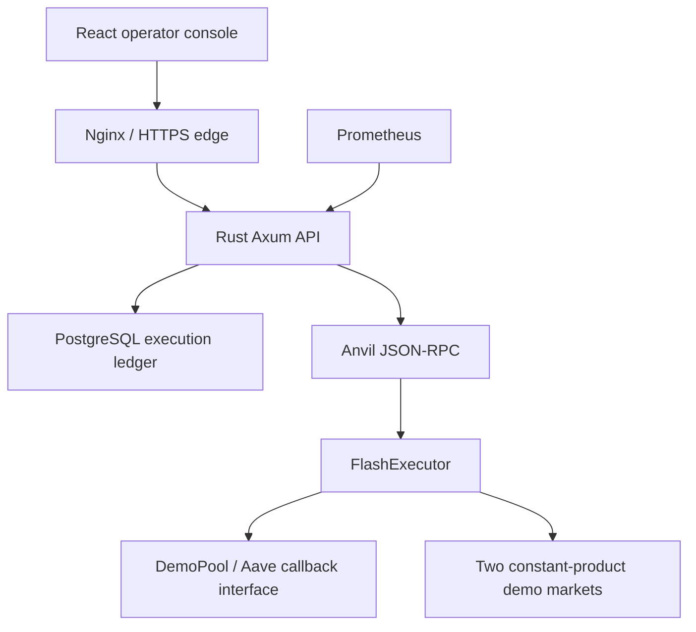
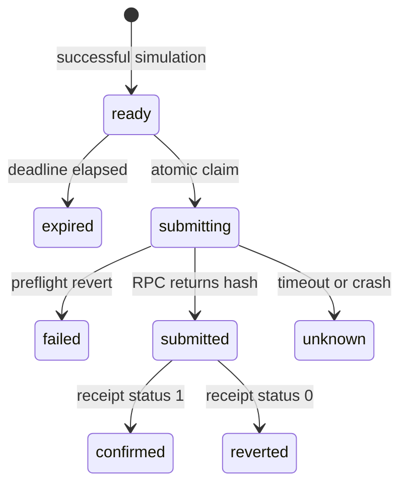

# Architecture

FlashRoute is an operator-controlled flash-loan arbitrage sandbox with real local EVM execution. The initial application deliberately runs only against chain 31337. The receiver follows Aave V3 `flashLoanSimple` callback semantics and calls V2-compatible routers. Neither the UI nor the scanner claims to be a live opportunity feed.

## Responsibilities

| Component | Responsibility | Trust boundary |
|---|---|---|
| Console | Parameters, route inspection, simulation review, manual submit | Untrusted input; no key persistence |
| Nginx | Same-origin API, request size and rate limits, headers | Public ingress |
| API | Validation, pinned-block quotes, premium read, preflight, state transitions | Holds operator API token; no wallet private key |
| PostgreSQL | Durable plans, atomic submit claims, outcomes and receipts | Private Docker network |
| Anvil | Local chain, unlocked development operator | Never exposed to host/public network by Compose |
| FlashExecutor | Authorization, callbacks, swap limits, balance-delta profit protection | Owner-selected lender, tokens, routers |
| Demo contracts | Repeatable lending and pricing fixture | Unrestricted demo tokens; intentionally non-production |

## Quote and cost model

Both swap quotes and the lender premium are read at the same explicit block number. The scanner evaluates both directions for one USDC-sized input. Token amounts are integers throughout the Rust backend and ABI; UI conversions accept up to six decimal places.

`estimated_net = final_quote - principal - rounded_flash_premium - 20_000_000`

The last term is a **20 demo USDC gas policy reserve**, not an ETH/USD oracle price. V2 quotes already include the AMM's 0.30% swap fee, so subtracting swap fees again would double-count them. UI dollar signs are display units for valueless demo tokens. Estimated net is never labeled realized profit.

## Simulation and submission

1. Validate route, amount, slippage and requested minimum profit.
2. Obtain block-pinned quotes and premium.
3. Encode a receiver plan with a 90-second deadline and slippage bounds.
4. Include the gas policy reserve in the contract minimum-profit floor.
5. Run `eth_call` and `eth_estimateGas` with the configured operator.
6. Persist a ready plan and transaction JSON.
7. On manual execution, atomically claim the row using `UPDATE ... WHERE status='ready' AND expires_at>now RETURNING`.
8. Re-estimate gas immediately before submission.
9. Submit via local Anvil `eth_sendTransaction` and persist the transaction hash.
10. A two-second receipt loop marks confirmed or reverted.

The same simulation UUID must appear in `Idempotency-Key`. Parallel API replicas share the database claim. Repeated requests return the existing state and do not resend. This is **at-most-once submission per stored plan**, not a general exactly-once blockchain guarantee.

Unknown outcomes require manual chain reconciliation; the worker never automatically retries an ambiguous transaction. There is an unavoidable RPC/database dual-write window, explicitly covered by the operational runbook.

## Contract accounting

The executor records its asset balance before borrowing. At callback completion it requires `balance >= starting_balance + principal + premium + min_profit`. After the lender pulls repayment it checks `final_balance >= starting_balance + min_profit` again. Pre-existing donations cannot subsidize an otherwise losing route. Intermediate tokens are tracked by acquired balance delta; old intermediate balances are not sold.

An active-plan hash binds callback data, the lender and initiator are checked, and the callback can be entered only once. Owner changes and rescue calls are prohibited while a plan is active. Approvals are reset and bounded to individual swap/debt amounts. Profit is paid to the owner after repayment.

## Intentional limits

No public mempool bot, production signer, private relay, multi-chain scanner, quote aggregation service, or promised financial return. The Docker/VPS application remains a local-market engineering sandbox. The optional fork test exercises real Aave/Uniswap contracts at a pinned historical block; a passing local test is not evidence of a profitable mainnet strategy.
